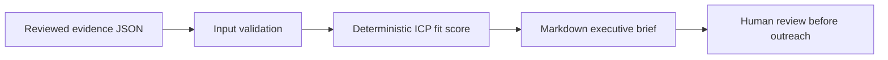

# Account Intelligence Agent

An **evidence-first account research CLI** for B2B business development. Turn a small, reviewed collection of public-source excerpts into a one-page executive briefing with citations, an ICP fit score, and role-specific conversation starters.

> **Status: v0.1 offline MVP.** This version does **not** search the web, scrape LinkedIn, call an LLM, discover contacts, or send outreach. Those are future, opt-in integrations—not current capabilities. The included sample is fictional; no proprietary Optimalex/customer data is used.

## Why this matters

A BDR needs a usable account brief, not a list of unsourced AI guesses. This prototype only reports claims provided with a source URL and verbatim supporting excerpt. It separates verified input from a suggested angle and leaves the final decision to a human.



## Quick start (Python 3.10+, standard library only)

```bash
python -m src.account_intelligence --input examples/fictional_account.json --output brief.md
python -m unittest discover -s tests -v
```

The brief includes account context, attributed evidence, explained fit score, and suggested conversations for Operations, Sales and Finance. `brief.md` is a local output and is excluded from Git. For your own input, use only publicly available information you are allowed to use and respect each publisher's terms.

## Input contract

```json
{
  "company": "Example Company",
  "domain": "example.com",
  "industry": "B2B software",
  "employee_count": 120,
  "target_industries": ["B2B software"],
  "employee_range": [50, 500],
  "evidence": [
    {
      "claim": "Company announced an expansion",
      "excerpt": "Exact short quotation from the source",
      "url": "https://example.com/news",
      "kind": "growth",
      "observed_on": "2026-10-01"
    }
  ]
}
```

`kind` must be one of `growth`, `operations`, `product`, `financial`, or `other`. Input text is untrusted; the program renders it as data, not as instructions. If evidence is empty the program refuses to produce a brief. A URL is an attribution label; the tool **does not fetch or verify the destination**. Always manually check source accuracy and recency.

## Scoring (transparent heuristic, not a prediction)

- Industry in target list: +35
- Employee count in target range: +25
- Growth evidence present: +20
- Operations evidence present: +20

The result is a transparent **fit score (0–100)**, not a lead-conversion estimate. Conversation starters are generic prompts based on evidenced categories, not assertions that the company has a particular pain point. No invented contact names, savings figures, or performance claims.

## Portfolio roadmap

1. Add opt-in search/provider adapters with API keys loaded from environment variables, caching, rate limits, domain/robots/ToS checks, and source retrieval timestamps.
2. Add optional LLM synthesis constrained to evidence IDs with output validation and unsupported-claim rejection.
3. Add human approval, CRM export, evaluation set, and measured time/quality benchmarks. No automated unsolicited outreach.

## Privacy and security

Never commit customer lists, private data, credentials, or confidential documents. Never assume public access means permission to scrape a site. This demo uses fictional data, makes no external requests, and sends no messages.
